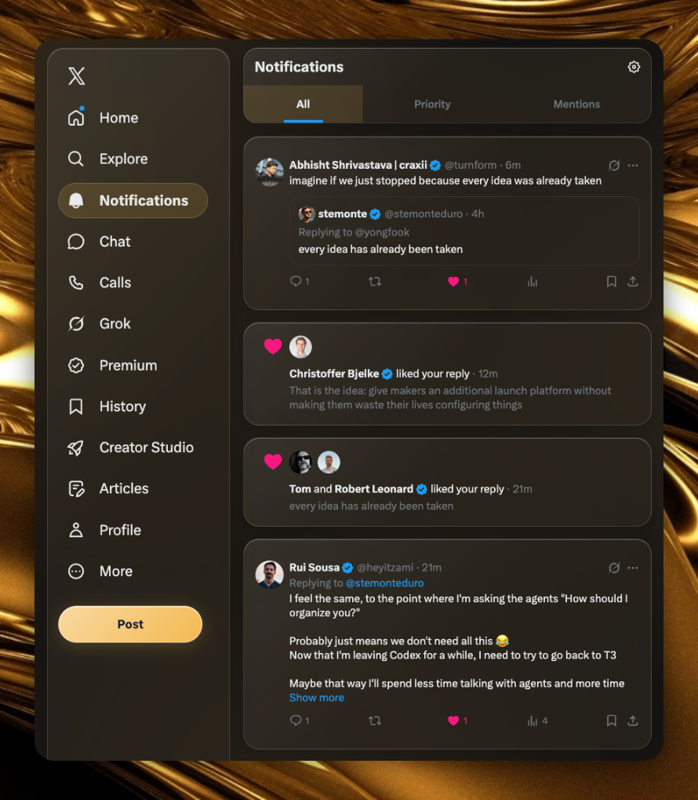

# XGlow


A liquid glass makeover for X. Same feed, a more personal look.

- **Glass throughout X.** Translucent cards, soft reflections and rounded surfaces across the feed, notifications, profile covers and Chat.
- **Your colors, your atmosphere.** Seven presets or any HEX color, with adjustable tint, blur and opacity. Changes apply instantly.
- **A focused, centered feed.** Hide the right sidebar and give your timeline room to breathe. Bring it back with one toggle.
- **Threads stay connected.** Related posts share a glass frame; post-detail replies keep X’s familiar flow and connection lines.
- **Light or dark.** Follows X’s appearance, with a lightweight mode and reduced-motion support.
- **Local and private.** No analytics, external services, API keys or account actions. Settings stay on your device.
- **Open source, easy to install.** Load the extension directly in Chrome, with no build step or dependencies.

**[Download the latest release](https://github.com/monteduro/xglow/releases/latest)** · **[Installation instructions](#install)**

## Theme examples

Two color themes for the same extension. You can switch presets or choose your own HEX color in Appearance.

### Aurora theme


### Amber theme



Screenshots show customized settings. The “Review” button in the Home image belongs to another extension.

Default appearance: **Amber**, **50% tint**, **10 px blur**, **0% glass opacity**. Reset restores these values; saved preferences take priority over defaults.

## Install

1. Open the [latest release](https://github.com/monteduro/xglow/releases/latest) and download the **`xglow-<version>.zip`** asset.
2. Extract the ZIP into a folder you will keep on your computer.
3. Open **`chrome://extensions`** in Chrome and enable **Developer mode** in the top-right corner.
4. Click **Load unpacked** and select the extracted folder containing **`manifest.json`**.
5. Reload your X tabs after saving any drafts.
6. Open **XGlow** from Chrome’s extensions menu to change colors, effects and sidebar visibility. Pin it to the toolbar for quick access.

**Installing from source instead?** Use **Code → Download ZIP** on this repository, extract it, and select its **`extension/`** folder in step 4.

No build step, account, API key or server is needed to use the extension. Chrome 111 or newer is required by the manifest.

Chrome Web Store publication is being prepared; there is no Store listing yet. Installation currently uses the GitHub release above.

Read the [privacy policy](docs/PRIVACY.md). Store listing materials and submission notes are in [docs/store](docs/store/LISTING.md).

To update a local installation, replace its files, click **Reload** on the extension’s card, then reload X.

## Privacy

The extension requests only `storage` and runs only on the X/Twitter domains listed in its manifest. Preferences are stored with `chrome.storage.local`.

The runtime inspects page structure and interface colors to apply CSS. It does not collect or store posts or private messages, send analytics, make network requests, or perform account actions. X Chat styling is applied inside its open shadow roots.

## Development

Development tools require Node.js 20 or newer. There are no npm dependencies.

```sh
npm run check
npm test
npm run build:preview
```

Launch the generated local demo through the **unlocalhost CLI**:

```sh
unlocalhost --yes setup . --slug xglow --features https,dev
unlocalhost up xglow
unlocalhost url xglow
```

The saved development command is `npm run dev`. It serves generated files from `public/` and uses the port provided by unlocalhost. `public/` is generated and excluded from Git.

See [Development](docs/DEVELOPMENT.md) for browser regression suites and DOM integration constraints, and [Contributing](CONTRIBUTING.md) for change guidelines.

## Package a release

```sh
npm run package
```

This requires the `zip` command and creates `dist/xglow-<version>.zip`. The archive contains extension files and the license, with `manifest.json` at its root. Tests, demos, screenshots and local notes are excluded.

## Compatibility

X changes its page structure regularly. Report layout problems with the affected route, viewport size and appearance settings; use sample content when possible. The effect uses CSS translucency and backdrop filters rather than physical glass refraction.

## License

[MIT](LICENSE). Independent project; not affiliated with X.
